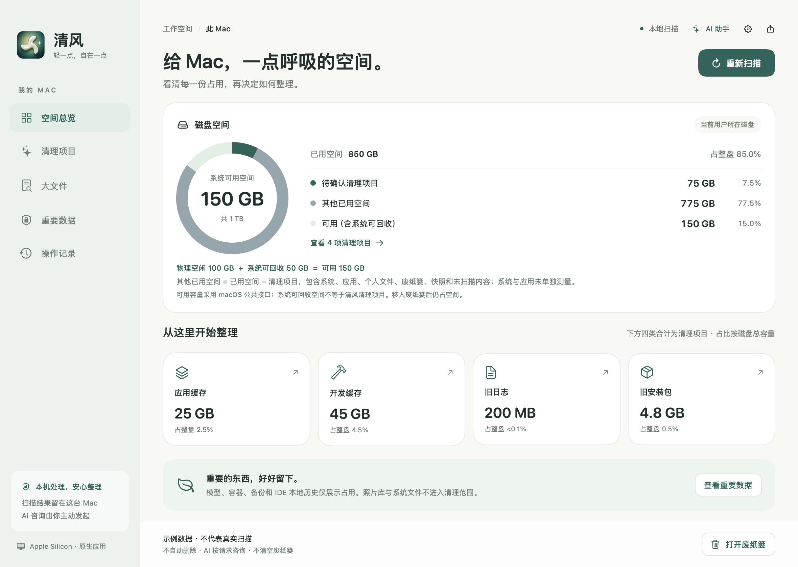
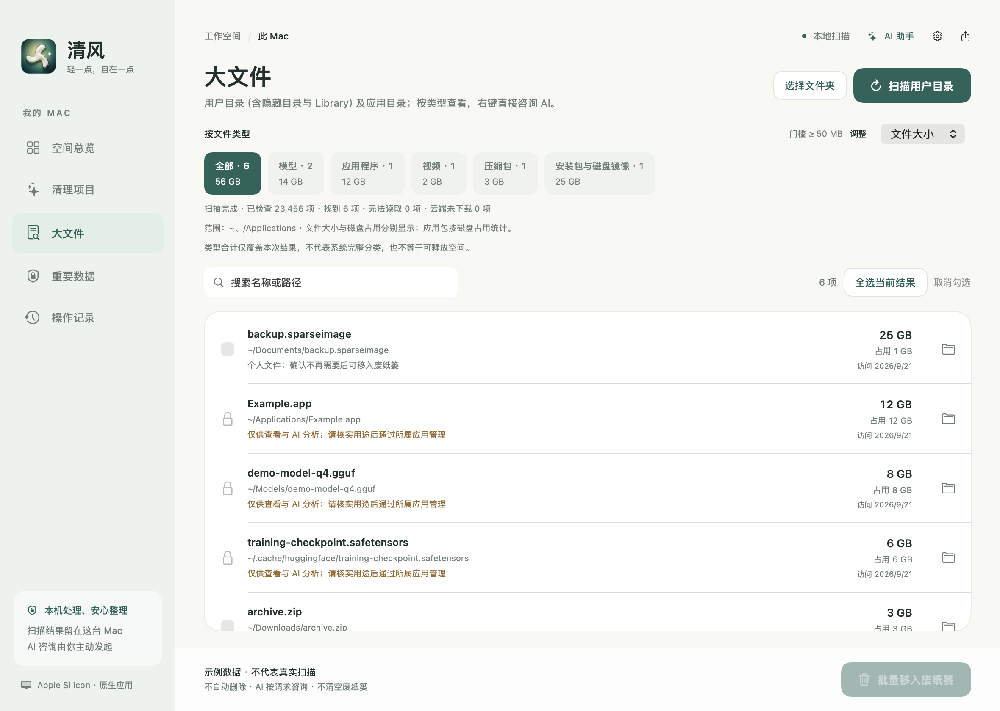
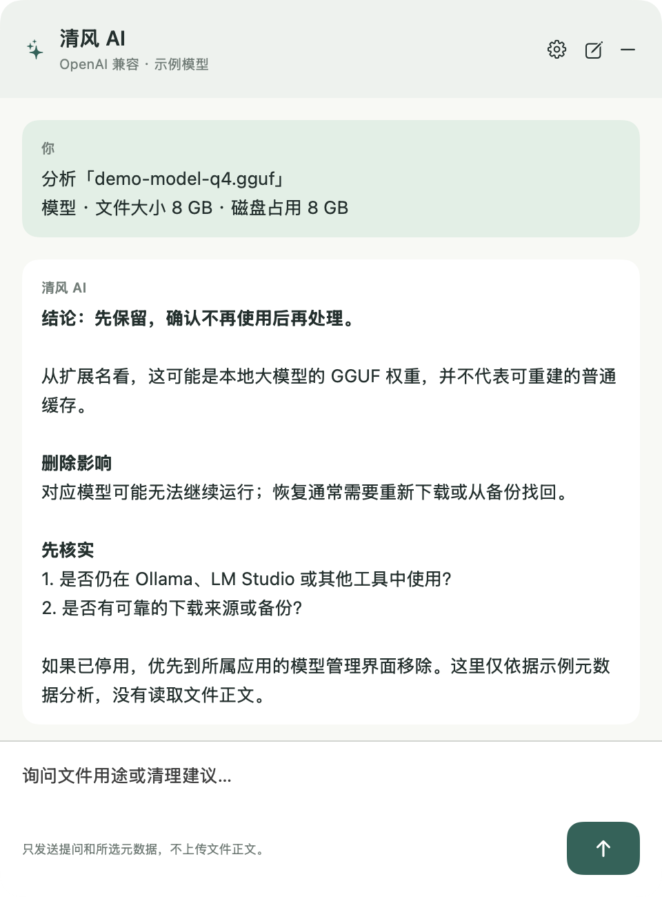
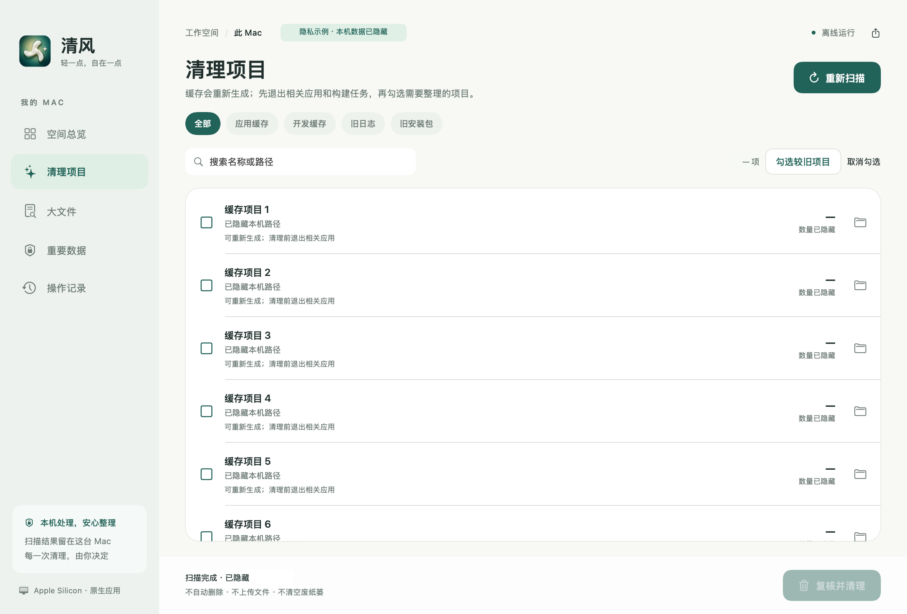

<p align="center">
  
</p>

<h1 align="center">Qingfeng · 清风</h1>

<p align="center">A little breathing room for your Mac.</p>

<p align="center">
  
  
  
  <a href="LICENSE"></a>
</p>

<p align="center">
  <strong>English</strong> · <a href="README.zh-CN.md">简体中文</a>
</p>

**[Download Qingfeng 1.2.5 for Apple Silicon](https://github.com/zealerFT/qingfeng/releases/download/v1.2.5/Qingfeng-1.2.5-AppleSilicon.zip)** · [Release notes](https://github.com/zealerFT/qingfeng/releases/tag/v1.2.5)

macOS 14 or later · Ready-to-run app · No Xcode or compilation required

Qingfeng is a native disk cleanup app for Apple Silicon Macs. It helps you review application caches, developer caches, old logs, installers, and large personal files, then moves the items you confirm to the macOS Trash. Important data remains available for inspection. An optional AI assistant can explain selected files and cleanup risks using a model service you configure.

The app is built with **SwiftUI and AppKit**, with no third-party dependencies. Its current interface is **Simplified Chinese**; this repository provides documentation in English and Chinese.

## Features

- **Understand storage use.** See system-available capacity, physical free space, system-reclaimable space, cleanup candidates, and other used space.
- **Keep control of cleanup.** Nothing is selected by default. Each cleanup requires confirmation and a fresh check of file metadata.
- **Remove large files in batches.** Select individual files or all eligible search results, review their paths and total size, and move them to Trash together.
- **Manage developer caches.** Find known caches from npm, pip, uv, Homebrew, Go, Xcode, JetBrains IDEs, and browser testing tools.
- **Inspect important data.** Models, container storage, device backups, Xcode archives, and IDE local history are view-only.
- **Find more large files.** Scan your home, hidden directories, Library, and Applications; filter by file type and compare file size with allocated disk space.
- **Adjust scan limits.** Configure directory and inventory limits independently, plus the minimum file size. Incomplete results are labeled.
- **Ask AI about a file.** Right-click a file to analyze it immediately. An icon inside the main window opens a streaming conversation with configurable cloud or local models.
- **Scan locally.** Scanning and cleanup work offline. AI requests run only when you send a question, choose file analysis, or test your configured service. No telemetry or Qingfeng account.

> Moving files to Trash does **not** immediately reclaim disk space. Review or restore them in Finder, then empty Trash yourself when ready. Qingfeng never empties it for you.

## Requirements

| Requirement | Details |
| --- | --- |
| Hardware | Apple Silicon Mac, including M3; native `arm64` builds |
| Operating system | macOS 14 or later |
| Building from source | Swift 6.0+ toolchain, supplied by compatible Xcode or Command Line Tools |
| App language | Simplified Chinese |

Not every supported macOS version and Apple Silicon model has been tested. Intel builds are not provided.

## Installation

### Packaged app

1. **[Download the Apple Silicon app](https://github.com/zealerFT/qingfeng/releases/download/v1.2.5/Qingfeng-1.2.5-AppleSilicon.zip)** (`Qingfeng-1.2.5-AppleSilicon.zip`).
2. Quit Qingfeng, double-click the ZIP to extract it, then drag **清风.app** into **Applications**. Choose **Replace** if an earlier version is installed.
3. Open **清风** from Applications. No developer tools or compilation are needed.

The automatically generated **Source code** downloads on the [release page](https://github.com/zealerFT/qingfeng/releases/latest) are for developers; the app download is the ZIP named **Qingfeng-1.2.5-AppleSilicon.zip**.

Current packages use an **ad-hoc signature** and are **not notarized by Apple**. If macOS blocks an app you have downloaded from this repository and trust, try opening it once, then use **System Settings → Privacy & Security → Open Anyway**, if offered. You can also build from source.

### Build from source

On an Apple Silicon Mac with a Swift 6.0+ toolchain:

```bash
git clone https://github.com/zealerFT/qingfeng.git
cd qingfeng
bash scripts/test.sh
bash scripts/install.sh
```

The install script builds an `arm64` release executable, generates the app icon, applies and verifies a local ad-hoc signature, then replaces the canonical `/Applications/清风.app`. It moves the previous user Applications copy and temporary build bundle to Trash so repeated updates do not create duplicate Launchpad entries. The downloadable archive remains available at:

```text
dist/Qingfeng-<version>-AppleSilicon.zip
```

Use `bash scripts/build.sh` when you only need build artifacts for packaging or CI.

## Usage

1. Click **开始扫描** (Start Scan). Scanning inspects filesystem metadata without deleting files or reading their contents.
2. Open **清理项目** (Cleanup Items). Review names, paths, sizes, and notes; use the folder button to reveal a location in Finder.
3. Quit the relevant apps and stop build tasks. Select only the items you no longer need.
4. Click **复核并清理** (Review & Clean), review the confirmation, and proceed. Changed, incomplete, or blocked items are skipped.
5. Check **操作记录** (History) and the system Trash. Restore anything you need before emptying Trash in Finder.

**勾选较旧项目** (Select Older Items) selects eligible items in the current list that have not changed for at least seven days and are not blocked by a detected running app. Review those selections yourself; age alone does not make a file unnecessary.

### Reading the storage overview

The overview uses macOS's public **available capacity for important usage** estimate: **physical free space + system-reclaimable space = available space**. Previously, Qingfeng displayed only physically free blocks, which can be much smaller than the capacity available in macOS Storage. If the expanded estimate is unavailable, Qingfeng falls back to physical free space and labels it accordingly.

The ring accounts for the whole disk: **cleanup candidates + other used space + available space = total capacity**. The four cleanup cards use the same denominator. Before a cleanup scan, used space is marked as awaiting classification.

**Other used space** is the remainder after subtracting cleanup candidates from used space. It includes system files, installed apps, personal files, Trash, snapshots, and unscanned data. System and app sizes are not measured separately. System-reclaimable space is an OS estimate, not a promise that Qingfeng can delete that amount. Cache estimates may overlap reclaimable or shared storage and are not an exact forecast of additional free space.

Qingfeng does not reproduce Apple's private Storage category index. Scan scope, permissions, snapshots, APFS sharing, and refresh timing can still produce differences. Large-file totals are a separate inventory and must not be added to the disk chart.

### Large files and batch cleanup

Open **大文件** (Large Files) and click **扫描用户目录** (Scan User Directory). The default scan covers the current user's entire home, including hidden locations and Library, plus `/Applications`. Use **选择文件夹** (Choose Folder) for another location or an external disk. Known model locations and common personal folders are visited before deep source/dependency trees. Scanning does not follow symbolic links, cross mounted filesystem boundaries within a root, or download cloud-only files.

Choose a type such as models, apps, videos, archives, or disk images to see its list. Sort by file size, allocated space, or last access. The scan summary shows scope, threshold, examined entries, unreadable entries, cloud placeholders, and any limits reached. Type totals describe the returned files, not complete system Storage categories. Last-access dates may be absent or approximate.

Select eligible files with checkboxes or **全选当前结果** (Select All Current Results), then click **批量移入废纸篓** (Move Selection to Trash). Review paths and confirm. Protected files, packages, hidden paths, and files outside your home remain view-only but can be sent to AI. Changing pages or type filters clears the selection. Personal files are excluded from the overview's cache-cleanup estimate.

### AI assistant

1. Open **AI 助手** or click the sparkle icon inside Qingfeng. The icon can be dragged within the main window and follows it when moved, resized, or minimized. Drag the conversation's title area to move it, and click **−** to return to the icon in the main window. Toolbar buttons accept the first click even while Qingfeng is inactive.
2. In the assistant's settings, choose a preset or protocol, enter the API base URL, model ID, and API key. Local services without authentication can leave the key empty. **测试连接** (Test Connection) sends a short request to that service.
3. Right-click an item in Cleanup Items, Large Files, or Important Data, then select **发送给 AI 分析** (Send to AI). Analysis starts immediately; no extra Enter is required. On first use, **保存并分析** (Save & Analyze) continues the pending request after configuration.
4. Ask follow-up questions, stop a response, retry a failed request, or start a new conversation. The minus button collapses the panel back to its icon; settings can hide the icon.

Saved API keys are reused in memory while Qingfeng runs, separately for each protocol and service address. Opening settings does not read Keychain. Leave the key field blank to keep the saved key, enter a new key to replace it, or select **保存时移除此服务的密钥** to remove it on save. Chat, file analysis, retries, and connection tests read credentials without requesting a password dialog, including the first request after launch. If Keychain is locked or denies access after an app update, the request remains in the conversation with an **授权并发送** (Authorize & Send) button. Only that button or **授权读取已存密钥…** in settings explicitly allows macOS authorization. Saving a replacement key can also require authorization.

| Protocol | Examples |
| --- | --- |
| OpenAI-compatible Chat Completions | OpenAI, DeepSeek, Qwen, SiliconFlow, Moonshot/Kimi, LM Studio, compatible gateways |
| Anthropic Messages | Claude-compatible endpoints |
| Gemini streaming GenerateContent | Google Gemini |
| Ollama chat | Local Ollama |

Model availability depends on your provider and account. Enter a model ID supported by the selected protocol. Remote endpoints require HTTPS; HTTP is allowed on loopback for local services. AI is optional and may incur provider fees.

Analysis includes the file path, parent folder, storage location, directory-purpose clues, sizes, dates, and protection flags. For Ollama hash blobs, Qingfeng checks small local manifest files and supplies exact matching model tags, layer types, and reference sources. Shared references and incomplete lookups are labeled; no matches do not establish that a blob is disposable. The chat shows the location and lets you expand **查看发送的分析资料** (View analysis material) to inspect the actual context sent.

The prompt asks for a retain / conditional cleanup / insufficient information decision, grounded in those facts, with deletion consequences, recovery cost, and the appropriate application's management entry point. Directory-based guesses are distinguished from verified references. **AI cannot delete files or run commands.** Review its advice before making your own cleanup decision.

### Scan settings

Open the gear button at the top right. Values such as `400000` and `400,000` are accepted for the directory limit. Click **保存并重新扫描** (Save & Rescan).

| Setting | Default | Range / behavior |
| --- | --- | --- |
| Per-directory measurement limit | 300,000 entries | 10,000–1,000,000; also applies to package measurement and cleanup revalidation |
| Large-file inventory traversal limit | 2,000,000 entries | 10,000–10,000,000 |
| Minimum large-file size | 50 MB | 1–10,000 MB; includes a file when logical or allocated size meets the threshold |
| Retained large-file results | Largest 20,000 | A notice appears if more match; scan a smaller folder for detail |

Settings persist locally. Saving clears old results and rescans the current scope. Higher limits can increase time and memory use. Incomplete directories remain view-only; read failures, cancellation, and truncation are reported explicitly. Packages are measured separately within the per-directory limit and shown as one view-only item.

## Cleanup scope

| Category | Included locations | Behavior |
| --- | --- | --- |
| Application caches | Allowed app directories in `~/Library/Caches` | Apple system cache identifiers and several reserved directories are excluded. Quit the relevant app first. |
| Developer caches | Known npm, pip, uv, Homebrew, Yarn, Go, Xcode DerivedData, Playwright, Cypress, and related cache paths | Tools may need to download or rebuild data afterward. |
| JetBrains caches | Per-version `caches`, `index`, `compile-server`, and `tmp` directories | Preserves LocalHistory and other IDE data. Running-app checks match the IDE product and version when available. |
| Old logs | Items under `~/Library/Logs` | The entire item must have no updates in the last 30 days. |
| Old installers | Top-level `.dmg`, `.pkg`, and `.xip` files in `~/Downloads` | At least 30 days old; ZIP archives and nested installers are excluded. |
| Large files | Current user home (including hidden folders and Library), `/Applications`, or a selected folder | Default 50 MB threshold; type filters, logical/allocated sizes, and explicit scan coverage. Eligible ordinary files can be moved to Trash after confirmation. Protected locations and packages remain view-only. |
| Important data | Known model directories, Docker/Podman storage, device backups, Xcode archives, JetBrains LocalHistory, and the pnpm shared store | Size inspection only; cleanup is disabled. |

Qingfeng does not provide app uninstallation, permanent deletion, container pruning, or cleanup of system directories, photo libraries, chat histories, source repositories, Keychain, or Time Machine backups. Symbolic links and special files prevent a candidate from being cleaned.

## Permissions and limitations

- **Access denied:** macOS can restrict individual folders. If needed, add Qingfeng under **System Settings → Privacy & Security → Full Disk Access**, then quit and reopen it. Ad-hoc signature changes after an update may require removing and re-adding the installed app.
- **Files changed during scanning:** active apps can delete or replace cache files. Quit the corresponding app and rescan. This is distinct from an access denial.
- **Scan limit reached:** increase the relevant directory or inventory limit, or choose a smaller folder. Granting more permissions does not change a scan limit.
- **App still running:** quit the app identified in the message and rescan. Detection cannot cover every custom cache location or command-line build task.
- **Storage estimates:** cleanup estimates reflect allocated disk blocks; the inventory also shows logical file size. APFS clones, snapshots, compression, and shared storage can make reclaimed space differ from the displayed total.

File metadata is checked again before cleanup. These checks reduce accidental changes but do not provide isolation against a malicious process racing to replace paths.

## Privacy

Scanning and cleanup operate locally without network access, analytics, or sign-in. Scan results stay in memory unless you export a report. Local cleanup history is stored at:

```text
~/Library/Application Support/清风/history.json
```

History is limited to 2,000 entries. Exported reports and history contain local paths; review them before sharing.

AI is opt-in through your own service configuration. Sending a question or selected file analysis sends conversation context and selected metadata (name, file and folder paths, directory-purpose clues, type, sizes, counts, dates, scan completeness, and protection notes) to that endpoint. Ollama analysis reads bounded small JSON files from the selected blob's sibling `manifests` directory locally, sending only matching model tags, layer types, declared sizes, reference paths, and lookup status. Other manifest fields are excluded. The current home prefix is replaced with `~`; remaining paths and model names can still be personal. **The selected file's body and the full scan report are not uploaded.** Connection testing sends only a test question. API keys are stored in macOS Keychain, while nonsecret model settings are stored locally. Conversations are kept in memory, with up to 16 recent messages used for context. Your provider's retention policies apply to remote requests. You can use a local Ollama or LM Studio endpoint.

## Development

```text
Sources/QingfengApp/      SwiftUI interface and AppKit integration
Sources/QingfengCore/     Scanning, safety rules, cleanup, and AI protocols
Tests/QingfengCoreTests/  Core checks using temporary fixtures
Tests/QingfengAITransportChecks/  Loopback streaming HTTP checks
Resources/               App metadata and icon source
scripts/                 Test, build, and icon generation scripts
docs/                    Screenshots and publishing instructions
```

Run `bash scripts/test.sh` for **58 core checks, 8 loopback HTTP transport checks, and 4 AppKit window checks**. They cover cleanup safety, disk accounting, file discovery, sparse files, limits, AI file context, shared model references, incomplete indexes, four AI protocols, streaming boundaries, authentication errors, redirect refusal, cancellation, screen placement, and toolbar hit testing. Tests use temporary files, offscreen views, and a local Python 3 fixture server; no real API keys or external model calls are needed. Run `bash scripts/test-assistant-window.sh` for just the window checks. The runners do not depend on XCTest.

Bug reports and focused pull requests are welcome. Include the app version, macOS version, chip, reproduction steps, and the exact message. Redact private paths and names. Changes to cleanup behavior should include regression checks using temporary fixtures.

See the [changelog](CHANGELOG.md) and [publishing guide](docs/PUBLISHING.md). The app icon was generated with Brain and packaged locally; its source prompt is included in [Resources/icon-prompt.txt](Resources/icon-prompt.txt).

## Screenshots

The overview, inventory, and AI images show **v1.2.0** rendered with fictional example data and a scripted example answer, not a real user scan or model response. The cleanup image is a redacted v1.0.0 capture. Embedded image metadata is removed. See [screenshot provenance](docs/screenshots/README.md).

### Storage overview



### File types and larger scan scope



### AI file analysis



### Review cleanup items



## License

[MIT](LICENSE) © 2026 zealerFT.
