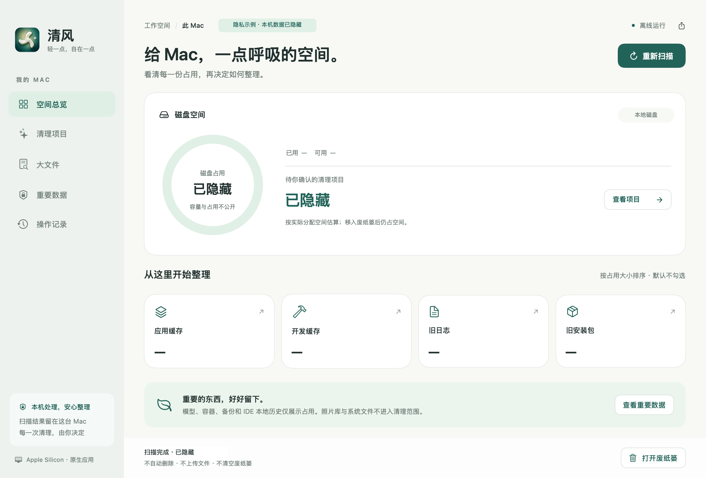
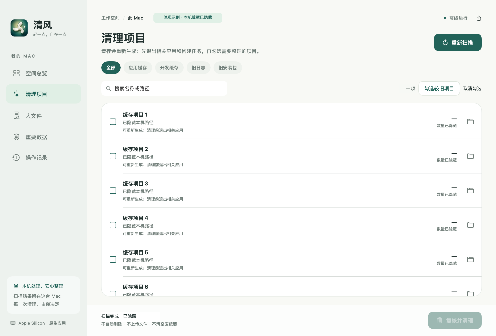

<p align="center">
  
</p>

<h1 align="center">Qingfeng · 清风</h1>

<p align="center">轻一点，自在一点。</p>

<p align="center">
  
  
  
  <a href="LICENSE"></a>
</p>

<p align="center">
  <a href="README.md">English</a> · <strong>简体中文</strong>
</p>

**[直接下载清风 1.0.2（Apple Silicon 安装包）](https://github.com/zealerFT/qingfeng/releases/download/v1.0.2/Qingfeng-1.0.2-AppleSilicon.zip)** · [版本说明](https://github.com/zealerFT/qingfeng/releases/tag/v1.0.2)

支持 macOS 14 及以上 · 下载即可安装 · 无需 Xcode 或自行编译

清风是一款为 Apple Silicon Mac 开发的原生、离线磁盘空间整理工具。它帮助你查看应用缓存、开发缓存、旧日志与安装包，并将你确认的项目移入系统废纸篓。大文件和重要数据仅供查看。

应用使用 **SwiftUI + AppKit**，无第三方依赖。当前应用界面为**简体中文**，仓库提供英文和中文文档。

## 功能

- **看清空间占用**：按类别查看磁盘与清理候选，支持搜索和 Finder 定位。
- **自主确认清理**：默认不勾选任何项目；每次操作都需确认，并重新检查文件属性。
- **整理开发缓存**：识别 npm、pip、uv、Homebrew、Go、Xcode、JetBrains IDE 和浏览器测试工具的已知缓存。
- **查看重要数据**：模型、容器存储、设备备份、Xcode 归档和 IDE 本地历史仅展示占用。
- **调整扫描上限**：单目录可设置 10,000–1,000,000 项，支持输入 `400000`。
- **完全离线运行**：无账户、分析上报、服务器或后台服务；操作记录保存在本机。

> **移入废纸篓不会立即释放磁盘空间。** 请先在 Finder 检查或还原，确认后再自行清空废纸篓。清风不会替你清空。

## 系统要求

| 项目 | 要求 |
| --- | --- |
| 硬件 | Apple Silicon Mac，包含 M3；原生 `arm64` 构建 |
| 操作系统 | macOS 14 及以上 |
| 源码构建 | Swift 6.0+ 工具链，可由兼容版本的 Xcode 或 Command Line Tools 提供 |
| 应用语言 | 简体中文 |

尚未覆盖所有支持的 macOS 版本和 Apple Silicon 机型的实机测试。不提供 Intel 构建。

## 安装

### 安装包

1. **[点击下载安装包](https://github.com/zealerFT/qingfeng/releases/download/v1.0.2/Qingfeng-1.0.2-AppleSilicon.zip)**：`Qingfeng-1.0.2-AppleSilicon.zip`。
2. 双击 ZIP 解压，将 **清风.app** 拖入「**应用程序**」。
3. 在「应用程序」中打开「**清风**」，无需安装开发工具或编译源码。

[版本页面](https://github.com/zealerFT/qingfeng/releases/latest) 自动生成的 **Source code** 是给开发者使用的源码；普通用户请选择 **Qingfeng-1.0.2-AppleSilicon.zip**。

当前安装包使用 **ad-hoc 本地签名**，**尚未经过 Apple 公证**。如果 macOS 阻止打开你从本仓库下载并信任的应用，可先尝试打开一次，再到「系统设置 → 隐私与安全性」查看是否提供「仍要打开」。也可以自行构建源码。

### 从源码构建

在已安装 Swift 6.0+ 工具链的 Apple Silicon Mac 上执行：

```bash
git clone https://github.com/zealerFT/qingfeng.git
cd qingfeng
bash scripts/test.sh
bash scripts/build.sh
open dist/清风.app
```

构建脚本会编译 `arm64` 发布版本、生成图标、应用并校验本地签名，输出：

```text
dist/清风.app
dist/Qingfeng-<版本>-AppleSilicon.zip
```

## 使用方法

1. 点击「**开始扫描**」。扫描只检查文件系统属性，不读取文件正文，也不删除文件。
2. 打开「**清理项目**」，查看名称、路径、大小和说明。文件夹按钮可在 Finder 定位。
3. 退出相关应用并停止构建任务，只勾选你确认不再需要的项目。
4. 点击「**复核并清理**」，核对列表后确认。内容已变化、扫描不完整或被占用保护拦截的项目会被跳过。
5. 在「**操作记录**」和系统废纸篓中检查结果。需要保留的内容应先还原，再自行清空废纸篓。

「**勾选较旧项目**」会选择当前列表中至少七天未更新、允许清理且未检测到相关应用运行的项目。仍需逐项确认用途，文件较旧不代表一定不再需要。

### 扫描设置

点击右上角齿轮，输入 `400000` 或 `400,000`，再点击「**保存并重新扫描**」。

| 设置 | 数值 |
| --- | --- |
| 单目录默认上限 | 300,000 项 |
| 可设置范围 | 10,000–1,000,000 项 |
| 大文件搜索上限 | 独立固定为 500,000 项 |

设置保存在本机，重启后仍生效。保存时会清除旧结果并重新扫描，清理前复核使用相同上限。上限越高，扫描时间和内存占用可能越大；超过上限的目录在完整扫描前仅供查看。

## 清理范围

| 类别 | 范围 | 规则 |
| --- | --- | --- |
| 应用缓存 | `~/Library/Caches` 中允许清理的应用目录 | 排除 Apple 系统缓存标识及部分保留目录；先退出相关应用。 |
| 开发缓存 | 已知 npm、pip、uv、Homebrew、Yarn、Go、Xcode DerivedData、Playwright、Cypress 等缓存路径 | 下次使用可能需要重新下载或编译。 |
| JetBrains 缓存 | 每个版本的 `caches`、`index`、`compile-server`、`tmp` | 保留 LocalHistory 和其他 IDE 数据；尽可能按产品与版本检查运行状态。 |
| 旧日志 | `~/Library/Logs` 下的项目 | 整个项目在最近 30 天内均未更新。 |
| 旧安装包 | `~/Downloads` 第一层的 `.dmg`、`.pkg`、`.xip` | 至少 30 天未更新；不包含 ZIP 和嵌套安装包。 |
| 大文件 | 下载、桌面、文稿、影片，或手动选择的文件夹 | 已分配空间至少 200 MB，最多展示最大的 200 项；仅支持 Finder 定位。 |
| 重要数据 | 已知模型目录、Docker/Podman 存储、设备备份、Xcode 归档、JetBrains LocalHistory、pnpm 共享存储 | 仅统计占用，禁止在清风中清理。 |

清风不提供应用卸载、永久删除、容器 prune，也不清理系统目录、照片库、聊天数据、代码仓库、Keychain 或 Time Machine 备份。包含符号链接或特殊文件的候选项目不能清理。

## 权限与限制

- **访问被拒绝**：macOS 可能限制部分目录。需要时可在「系统设置 → 隐私与安全性 → 完全磁盘访问权限」添加清风，然后退出重开。更新导致 ad-hoc 签名变化时，可能需要移除旧条目并重新添加当前应用。
- **扫描时文件变化**：运行中的应用可能删除或替换缓存。退出对应应用后重扫；这与权限被拒绝不同。
- **达到扫描上限**：提高单目录上限，或为大文件搜索选择更小的文件夹。修改磁盘权限不会改变扫描上限。
- **相关应用仍在运行**：退出提示中的应用后重扫。检测无法覆盖所有自定义缓存目录和命令行构建任务。
- **空间估算**：数值来自已分配磁盘块；APFS 克隆、快照、压缩和共享存储可能使实际释放空间不同于扫描合计。

清理前会再次核对文件属性。这能减少误操作，但不能对恶意进程在最后瞬间替换路径提供隔离保证。

## 隐私

应用不发起网络请求，无分析上报或登录。扫描结果保存在内存中，除非你主动导出报告。本地操作记录位于：

```text
~/Library/Application Support/清风/history.json
```

最多保留 2,000 条操作记录。导出报告和历史记录含本机路径，提交 Issue 前请检查并脱敏。

## 开发

```text
Sources/QingfengApp/      SwiftUI 界面与 AppKit 集成
Sources/QingfengCore/     扫描、安全规则、应用检测与清理
Tests/QingfengCoreTests/  使用临时数据的文件系统检查
Resources/               应用元数据与图标源文件
scripts/                 测试、构建与图标生成脚本
docs/                    截图与发布说明
```

执行 `bash scripts/test.sh` 运行独立的 `QingfengCoreChecks`。当前包含 30 项检查，覆盖路径边界、符号链接、扫描后变化、扫描上限、应用占用，以及自建临时文件的废纸篓行为。检查程序不依赖 XCTest。

欢迎提交 Bug 和范围明确的 Pull Request。请提供应用版本、macOS 版本、芯片、复现步骤和完整提示，隐藏私人路径与名称。修改清理逻辑时，请使用临时测试数据补充回归检查。

另见[更新记录](CHANGELOG.md)和[发布指南](docs/PUBLISHING.md)。应用图标由 Brain 生成原画，再在本地完成打包；[Resources/icon-prompt.txt](Resources/icon-prompt.txt) 保留了生成提示词。

## 应用截图

以下截图来自 **v1.0.0** 的中文界面，已做隐私处理：本机容量、占用图表、项目名称、路径、数量及扫描时间均替换为通用占位内容。当前版本增加了扫描设置，并细化了扫描提示，详见[更新记录](CHANGELOG.md)。

### 空间总览



### 清理项目



## 许可证

[MIT](LICENSE) © 2026 zealerFT。
