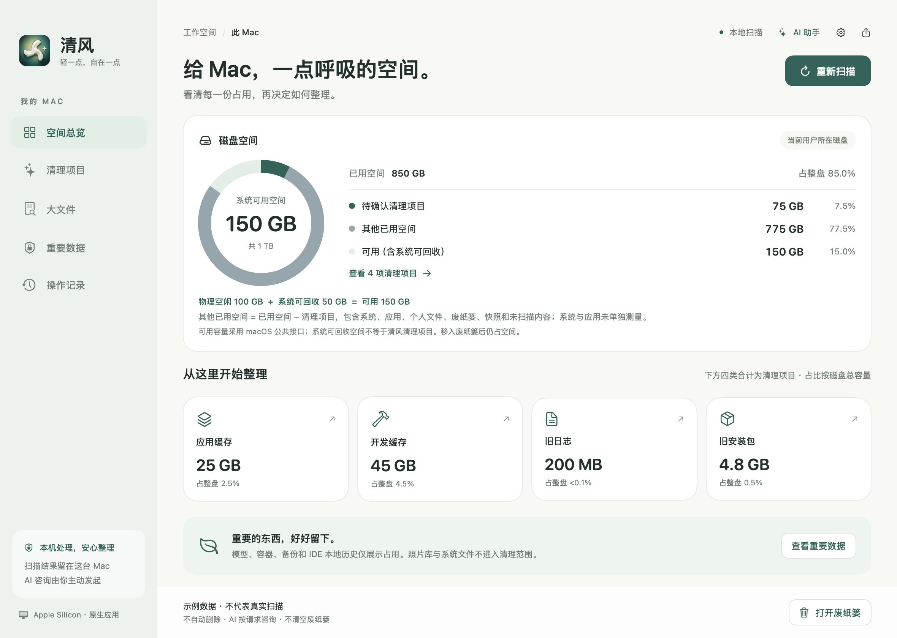
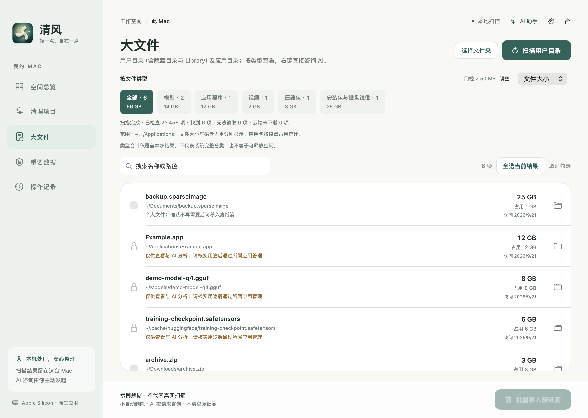
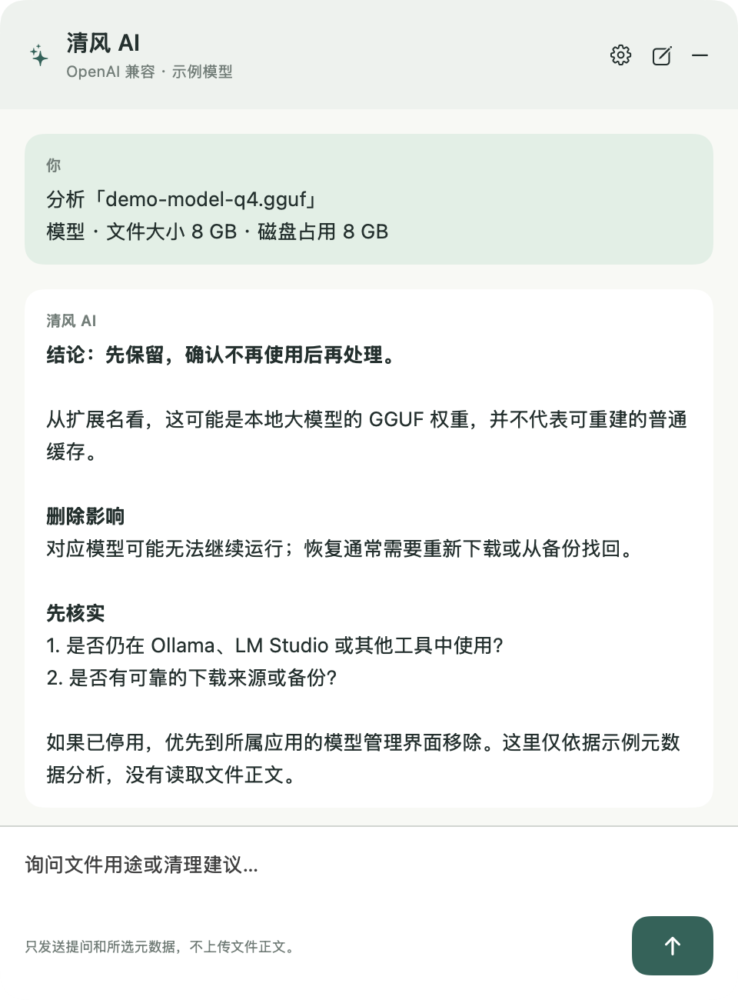
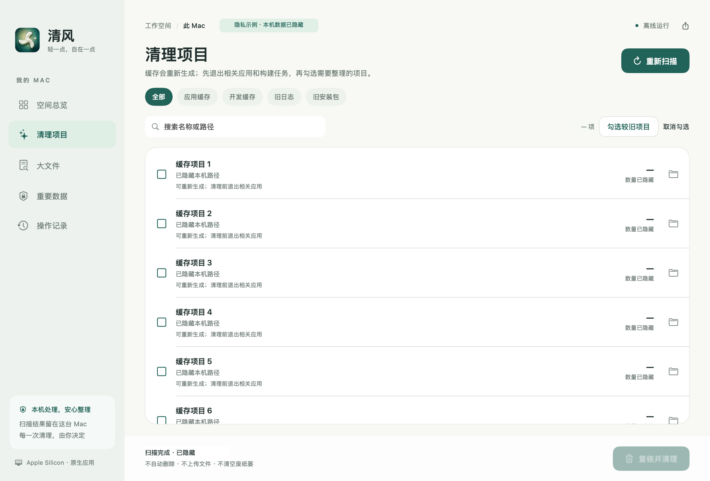

<p align="center">
  
</p>

<h1 align="center">Qingfeng · 清风</h1>

<p align="center">轻一点，自在一点。</p>

<p align="center">
  
  
  
  <a href="LICENSE"></a>
</p>

<p align="center">
  <a href="README.md">English</a> · <strong>简体中文</strong>
</p>

**[直接下载清风 1.2.1（Apple Silicon 安装包）](https://github.com/zealerFT/qingfeng/releases/download/v1.2.1/Qingfeng-1.2.1-AppleSilicon.zip)** · [版本说明](https://github.com/zealerFT/qingfeng/releases/tag/v1.2.1)

支持 macOS 14 及以上 · 下载即可安装 · 无需 Xcode 或自行编译

清风是一款为 Apple Silicon Mac 开发的原生磁盘空间整理工具。它帮助你查看应用缓存、开发缓存、旧日志、安装包与个人大文件，并将你确认的项目移入系统废纸篓。重要数据仅供查看。可选的 AI 助手支持自行配置模型，用于解释所选文件的用途和清理影响。

应用使用 **SwiftUI + AppKit**，无第三方依赖。当前应用界面为**简体中文**，仓库提供英文和中文文档。

## 功能

- **看清空间占用**：区分物理空闲、系统可回收与系统可用空间，并展示清理项目及其他已用空间。
- **自主确认清理**：默认不勾选任何项目；每次操作都需确认，并重新检查文件属性。
- **批量整理大文件**：逐项勾选或全选当前可操作的搜索结果，核对路径与总大小后，一起移入废纸篓。
- **整理开发缓存**：识别 npm、pip、uv、Homebrew、Go、Xcode、JetBrains IDE 和浏览器测试工具的已知缓存。
- **查看重要数据**：模型、容器存储、设备备份、Xcode 归档和 IDE 本地历史仅展示占用。
- **发现更多大文件**：扫描整个用户目录、隐藏位置、Library 和应用目录；按类型筛选，区分文件大小和实际占用。
- **调整扫描范围与上限**：单目录、大文件遍历上限和大小门槛可分别设置；结果不完整时明确提示。
- **直接咨询 AI**：右键文件即可自动分析；可拖动桌面悬浮图标，使用自行配置的云端或本地模型。
- **本地扫描与清理**：整理功能离线可用；只有发送问题、选择 AI 分析或测试连接时才请求模型服务。无遥测上报或清风账户。

> **移入废纸篓不会立即释放磁盘空间。** 请先在 Finder 检查或还原，确认后再自行清空废纸篓。清风不会替你清空。

## 系统要求

| 项目 | 要求 |
| --- | --- |
| 硬件 | Apple Silicon Mac，包含 M3；原生 `arm64` 构建 |
| 操作系统 | macOS 14 及以上 |
| 源码构建 | Swift 6.0+ 工具链，可由兼容版本的 Xcode 或 Command Line Tools 提供 |
| 应用语言 | 简体中文 |

尚未覆盖所有支持的 macOS 版本和 Apple Silicon 机型的实机测试。不提供 Intel 构建。

## 安装

### 安装包

1. **[点击下载安装包](https://github.com/zealerFT/qingfeng/releases/download/v1.2.1/Qingfeng-1.2.1-AppleSilicon.zip)**：`Qingfeng-1.2.1-AppleSilicon.zip`。
2. 退出清风，双击 ZIP 解压，将 **清风.app** 拖入「**应用程序**」；已有旧版本时选择「**替换**」。
3. 在「应用程序」中打开「**清风**」，无需安装开发工具或编译源码。

[版本页面](https://github.com/zealerFT/qingfeng/releases/latest) 自动生成的 **Source code** 是给开发者使用的源码；普通用户请选择 **Qingfeng-1.2.1-AppleSilicon.zip**。

当前安装包使用 **ad-hoc 本地签名**，**尚未经过 Apple 公证**。如果 macOS 阻止打开你从本仓库下载并信任的应用，可先尝试打开一次，再到「系统设置 → 隐私与安全性」查看是否提供「仍要打开」。也可以自行构建源码。

### 从源码构建

在已安装 Swift 6.0+ 工具链的 Apple Silicon Mac 上执行：

```bash
git clone https://github.com/zealerFT/qingfeng.git
cd qingfeng
bash scripts/test.sh
bash scripts/install.sh
```

安装脚本会编译 `arm64` 发布版本、生成图标、应用并校验本地 ad-hoc 签名，然后把最新版本覆盖安装到 `/Applications/清风.app`。它会把旧的用户「应用程序」副本和临时构建副本移入废纸篓，反复更新不会再生成重复的 Launchpad 图标。可下载的压缩包仍保存在：

```text
dist/Qingfeng-<版本>-AppleSilicon.zip
```

如果只需要为发布或 CI 生成构建产物，可使用 `bash scripts/build.sh`。

## 使用方法

1. 点击「**开始扫描**」。扫描只检查文件系统属性，不读取文件正文，也不删除文件。
2. 打开「**清理项目**」，查看名称、路径、大小和说明。文件夹按钮可在 Finder 定位。
3. 退出相关应用并停止构建任务，只勾选你确认不再需要的项目。
4. 点击「**复核并清理**」，核对列表后确认。内容已变化、扫描不完整或被占用保护拦截的项目会被跳过。
5. 在「**操作记录**」和系统废纸篓中检查结果。需要保留的内容应先还原，再自行清空废纸篓。

「**勾选较旧项目**」会选择当前列表中至少七天未更新、允许清理且未检测到相关应用运行的项目。仍需逐项确认用途，文件较旧不代表一定不再需要。

### 理解空间总览

可用容量采用 macOS 公开的「重要用途可用容量」接口：**物理空闲 + 系统可回收 = 可用空间**。旧版仅显示物理空闲，因此可能明显小于 macOS「储存空间」中的可用容量。系统无法提供扩展估算时，清风会回退到物理空闲并标明口径。

环形图展示整块磁盘：**清理项目 + 其他已用空间 + 可用空间 = 磁盘总容量**。四张清理卡片也使用磁盘总容量计算占比，未扫描时标为「待分类」。

「**其他已用空间**」是已用空间减去清理项目后的差额，包含系统、应用、个人文件、废纸篓、快照和未扫描内容；系统与应用未分别测量。系统可回收容量是操作系统估算，不等于清风可以删除的容量；缓存估算可能与可回收或共享存储重叠，不能当成新增空闲空间的精确承诺。

清风不复刻 Apple 私有的储存分类索引。扫描范围、权限、快照、APFS 共享和刷新时机仍可能造成差异。「大文件」是独立的文件清单，不应再次加到磁盘总览中。

### 大文件与批量整理

进入「**大文件**」，点击「**扫描用户目录**」。默认范围是当前用户整个主目录（含隐藏位置和 Library）以及 `/Applications`；「**选择文件夹**」可指定其他目录或外置磁盘。已知模型位置和常用个人文件夹会优先于深层源码与依赖目录扫描。不跟随符号链接，不在单个根目录内跨越挂载边界，不下载仅存在云端的文件。

点击模型、应用、视频、压缩包、磁盘镜像等类型，查看对应清单。可按文件大小、磁盘占用、最近访问排序。摘要展示范围、门槛、已检查数量、读取失败、云端未下载及扫描限制。分类合计只代表本次结果，不是系统完整分类占用；访问时间可能缺失或不精确。

逐项勾选或「**全选当前结果**」，再点击「**批量移入废纸篓**」，核对路径后确认。受保护文件、应用包、隐藏路径和主目录外的文件仍仅供查看与 AI 分析。切换页面或类型会清空勾选，个人文件不计入总览的缓存清理估算。

### AI 助手

1. 点击「**AI 助手**」或桌面星光悬浮图标。图标可任意拖动，在其他应用前也能使用；清风退出后浮窗随之关闭。
2. 在助手设置中选择预设或接口协议，填写 API 服务地址、模型 ID 和密钥。本机无鉴权服务可不填密钥。「**测试连接**」会向所选服务发送一条短请求。
3. 在清理项目、大文件或重要数据中右键，选择「**发送给 AI 分析**」，立即开始，无需再回车。首次使用时，「**保存并分析**」会在完成配置后继续这条请求。
4. 可追问、停止回答、重试失败请求或开始新对话。减号收起为图标，设置中可隐藏图标。

| 接口协议 | 示例服务 |
| --- | --- |
| OpenAI 兼容 Chat Completions | OpenAI、DeepSeek、通义千问、硅基流动、Moonshot/Kimi、LM Studio、兼容网关 |
| Anthropic Messages | Claude 兼容接口 |
| Gemini 流式 GenerateContent | Google Gemini |
| Ollama chat | 本机 Ollama |

请填写所选协议支持的模型 ID，具体可用模型取决于服务商与账户。远程地址要求 HTTPS，本机回环服务允许 HTTP。AI 为可选功能，服务商可能收取调用费用。

分析提示词要求模型解释用途、区分事实与推测、评估删除影响和恢复成本，并给出核实步骤；请求附带所选元数据与现有保护标记。**AI 不会执行命令或自动删除文件**，请核实建议后自行决定。

### 扫描设置

点击右上角齿轮；单目录上限支持 `400000` 或 `400,000`，然后点击「**保存并重新扫描**」。

| 设置 | 默认值 | 范围 / 行为 |
| --- | --- | --- |
| 单目录测量上限 | 300,000 项 | 10,000–1,000,000；也用于应用包统计和清理复核 |
| 大文件遍历上限 | 2,000,000 项 | 10,000–10,000,000 |
| 大文件大小门槛 | 50 MB | 1–10,000 MB；文件大小或磁盘占用任一达到即可 |
| 大文件保留结果 | 最大的 20,000 项 | 超出会明确提示，可缩小文件夹范围查看 |

设置保存在本机。保存会清除旧结果并重扫当前范围。提高上限可能增加时间与内存；未完整测量的目录仅供查看。读取失败、取消和截断都会提示。应用包按单目录上限单独测量，作为一个只读项目展示。

## 清理范围

| 类别 | 范围 | 规则 |
| --- | --- | --- |
| 应用缓存 | `~/Library/Caches` 中允许清理的应用目录 | 排除 Apple 系统缓存标识及部分保留目录；先退出相关应用。 |
| 开发缓存 | 已知 npm、pip、uv、Homebrew、Yarn、Go、Xcode DerivedData、Playwright、Cypress 等缓存路径 | 下次使用可能需要重新下载或编译。 |
| JetBrains 缓存 | 每个版本的 `caches`、`index`、`compile-server`、`tmp` | 保留 LocalHistory 和其他 IDE 数据；尽可能按产品与版本检查运行状态。 |
| 旧日志 | `~/Library/Logs` 下的项目 | 整个项目在最近 30 天内均未更新。 |
| 旧安装包 | `~/Downloads` 第一层的 `.dmg`、`.pkg`、`.xip` | 至少 30 天未更新；不包含 ZIP 和嵌套安装包。 |
| 大文件 | 当前用户主目录（含隐藏位置与 Library）、`/Applications`，或所选文件夹 | 默认门槛 50 MB，支持类型筛选，显示逻辑大小、实际占用和扫描覆盖情况；允许清理的普通文件需确认后移入废纸篓，受保护位置与应用包仅供查看。 |
| 重要数据 | 已知模型目录、Docker/Podman 存储、设备备份、Xcode 归档、JetBrains LocalHistory、pnpm 共享存储 | 仅统计占用，禁止在清风中清理。 |

清风不提供应用卸载、永久删除、容器 prune，也不清理系统目录、照片库、聊天数据、代码仓库、Keychain 或 Time Machine 备份。包含符号链接或特殊文件的候选项目不能清理。

## 权限与限制

- **访问被拒绝**：macOS 可能限制部分目录。需要时可在「系统设置 → 隐私与安全性 → 完全磁盘访问权限」添加清风，然后退出重开。更新导致 ad-hoc 签名变化时，可能需要移除旧条目并重新添加当前应用。
- **扫描时文件变化**：运行中的应用可能删除或替换缓存。退出对应应用后重扫；这与权限被拒绝不同。
- **达到扫描上限**：提高对应的单目录或大文件遍历上限，或选择更小的文件夹。修改磁盘权限不会改变扫描上限。
- **相关应用仍在运行**：退出提示中的应用后重扫。检测无法覆盖所有自定义缓存目录和命令行构建任务。
- **空间估算**：清理估算来自已分配磁盘块，大文件另外显示逻辑大小；APFS 克隆、快照、压缩和共享存储可能使实际释放空间不同于扫描合计。

清理前会再次核对文件属性。这能减少误操作，但不能对恶意进程在最后瞬间替换路径提供隔离保证。

## 隐私

扫描与清理在本机完成，无网络请求、分析上报或登录。扫描结果保存在内存中，除非主动导出。本地操作记录位于：

```text
~/Library/Application Support/清风/history.json
```

最多保留 2,000 条。导出报告和历史记录包含本机路径，分享前请检查并脱敏。

AI 由你自行配置并主动发起。请求会将对话上下文和所选项目元数据（名称、路径、类型、大小、数量、时间、完整性与保护说明）发送给指定服务。主目录前缀替换为 `~`，其余路径片段仍可能包含私人信息。**不上传文件正文或整盘扫描报告**；连接测试只发送测试提问。密钥存入 macOS 钥匙串，非密钥设置保存在本机。对话仅保留在内存中，最多使用最近 16 条作为上下文。远程请求遵循服务商的数据保留政策，也可以选择本机 Ollama 或 LM Studio。

## 开发

```text
Sources/QingfengApp/      SwiftUI 界面与 AppKit 集成
Sources/QingfengCore/     扫描、安全规则、清理与 AI 协议
Tests/QingfengCoreTests/  使用临时数据的核心检查
Tests/QingfengAITransportChecks/  本机流式 HTTP 检查
Resources/               应用元数据与图标源文件
scripts/                 测试、构建与图标生成脚本
docs/                    截图与发布说明
```

执行 `bash scripts/test.sh`，运行 **53 项核心检查和 8 项本机 HTTP 通信检查**。覆盖清理安全、容量口径、扩大文件发现范围、稀疏文件、扫描限制、四种 AI 协议、流式边界、鉴权错误、拒绝重定向和取消。使用临时文件及本机 Python 3 模拟服务，不需要真实 API Key 或外部模型。检查程序不依赖 XCTest。

欢迎提交 Bug 和范围明确的 Pull Request。请提供应用版本、macOS 版本、芯片、复现步骤和完整提示，隐藏私人路径与名称。修改清理逻辑时，请使用临时测试数据补充回归检查。

另见[更新记录](CHANGELOG.md)和[发布指南](docs/PUBLISHING.md)。应用图标由 Brain 生成原画，再在本地完成打包；[Resources/icon-prompt.txt](Resources/icon-prompt.txt) 保留了生成提示词。

## 应用截图

空间总览、大文件和 AI 截图为 **v1.2.0**，使用虚构数据及预写示例回答渲染，并非真实扫描或模型输出。清理项目为已脱敏的 v1.0.0 截图。图片已去除嵌入元数据，详见[截图来源](docs/screenshots/README.md)。

### 空间总览



### 按类型查看大文件



### AI 文件分析



### 清理项目



## 许可证

[MIT](LICENSE) © 2026 zealerFT。
